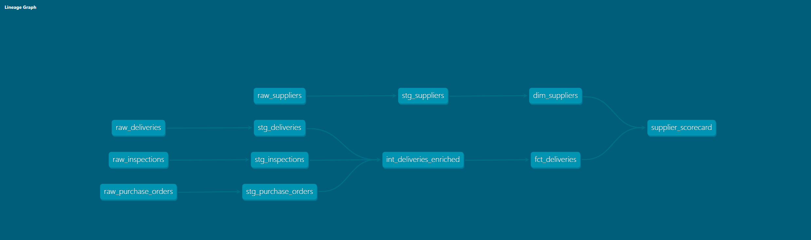
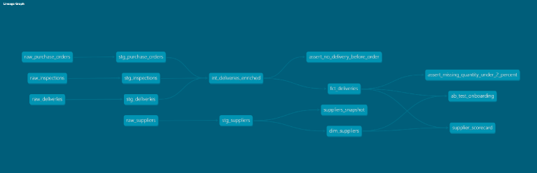

# Supplier Performance Analytics (dbt + DuckDB)

**One trusted definition of supplier OTIF, with tests, docs and an A/B analysis.**

## The problem
Procurement, Planning and Quality each calculated supplier OTIF in their own spreadsheet,
and the numbers never matched. Meetings started with "which number is right?" instead of
"what do we do about it?".

## The decision it drives
Which suppliers enter the **supplier development plan** (OTIF below 85% for two months in a row),
and whether the **new onboarding program** is worth keeping.

## Lineage
Four raw sources, one trusted metric.



<details>
<summary>Full project graph (tests, snapshot and A/B analysis)</summary>



</details>

## What's inside
| Layer | Models | Purpose |
|---|---|---|
| staging | `stg_suppliers`, `stg_purchase_orders`, `stg_deliveries`, `stg_inspections` | Clean types, mixed date formats, trimmed names, deduplicated deliveries |
| intermediate | `int_deliveries_enriched` | The **only** place where on-time and in-full are defined |
| marts | `dim_suppliers`, `fct_deliveries`, `supplier_scorecard` | Self-serve tables for BI (metrics declared for Lightdash in YAML) |
| snapshots | `suppliers_snapshot` | SCD type 2 history of supplier status |
| analyses | `ab_test_onboarding` | Two-proportion z-test: new vs. legacy onboarding |

**Tests:** unique, not_null, relationships, accepted_values, `dbt_utils.accepted_range`
(OTIF between 0 and 1), unique supplier-month grain, and two custom tests
(no delivery before its order; missing quantities under 2%).

The source data is **fictional** and intentionally messy (mixed date formats, duplicates, null quantities)
to show how staging handles real-world data.

## How to run
```bash
python -m venv .venv && source .venv/bin/activate   # Windows: .venv\Scripts\activate
pip install -r requirements.txt
python scripts/generate_data.py
dbt deps --profiles-dir .
dbt build --profiles-dir .
dbt docs generate --profiles-dir . && dbt docs serve --profiles-dir .
```
CI runs `dbt build` on every push (GitHub Actions).

## How AI was used
I used AWS Quick to draft and review models, tests and documentation, then validated every
model against the data and the business rules. AI speeds up the writing; the definitions
and the checks are mine.

## Background
I spent 15 years managing supplier OTIF, quality and capacity in manufacturing. This project
turns that experience into a reusable, tested analytics model.
